<!-- ============ Living header ============ -->

  <picture>
    <source media="(prefers-color-scheme: dark)" srcset="bloom-header-night.svg" />
    
  </picture>

### Hi, I'm Wei Cai

I'm a Software Engineering master's student at USTC. I work on multi-agent systems,
multi-objective optimization, deep learning, and language models.

[Website](https://caiwei1030.github.io/) · [GitHub](https://github.com/caiwei1030)

 

<!-- TECH_GARDEN_START -->

      
 
    
 
     
 
     

<b>Field guide</b> - open to read the stack

 

 
 
 
 

<!-- TECH_GARDEN_END -->

 

<!-- ============ Contribution snake ============ -->

  <picture>
    <source media="(prefers-color-scheme: dark)" srcset="https://raw.githubusercontent.com/caiwei1030/caiwei1030/output/github-contribution-grid-snake-dark.svg" />
    
  </picture>

 

<!-- ============ Living footer ============ -->

  <picture>
    <source media="(prefers-color-scheme: dark)" srcset="garden-footer-night.svg" />
    
  </picture>

The living banner and seasonal footer are powered by <a href="https://github.com/yuki4266/living-scene">living-scene</a>.

